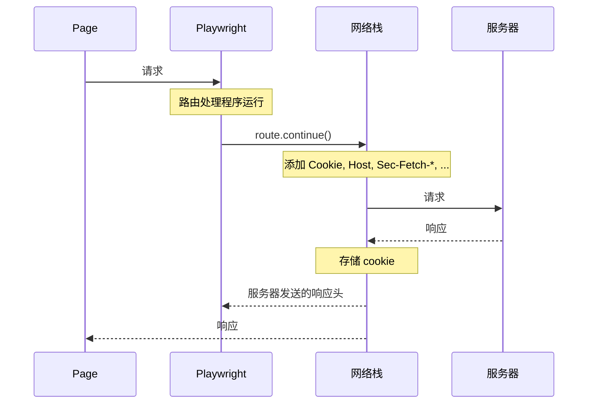

# 网络

## 简介

Playwright 提供 API 来**监控**和**修改**浏览器网络流量，包括 HTTP 和 HTTPS。页面发出的任何请求，包括 [XHR](https://developer.mozilla.org/en-US/docs/Web/API/XMLHttpRequest) 和
[fetch](https://developer.mozilla.org/en-US/docs/Web/API/Fetch_API) 请求，都可以被跟踪、修改和处理。

## Mock API

查看我们的 [API Mock 指南](./mock.md) 了解更多关于如何：
- Mock API 请求而不真正调用 API
- 执行 API 请求并修改响应
- 使用 HAR 文件来 mock 网络请求。

## HTTP 认证

执行 HTTP 认证。

```csharp
using var context = await Browser.NewContextAsync(new()
{
    HttpCredentials = new HttpCredentials
    {
        Username = "bill",
        Password = "pa55w0rd"
    },
});
var page = await context.NewPageAsync();
await page.GotoAsync("https://example.com");
```

## HTTP 代理

你可以配置页面通过 HTTP(S) 代理或 SOCKSv5 加载。代理可以为整个浏览器全局设置，也可以为每个浏览器上下文单独设置。

你可以选择性地为 HTTP(S) 代理指定用户名和密码，也可以指定要绕过 [`proxy`](/dotnet/api/class-browser#browser-new-context-option-proxy) 的主机。

以下是全局代理的示例：

```csharp
var proxy = new Proxy
{
    Server = "http://myproxy.com:3128",
    Username = "user",
    Password = "pwd"
};
await using var browser = await BrowserType.LaunchAsync(new()
{
    Proxy = proxy
});
```

也可以按上下文指定：

```csharp
await using var browser = await BrowserType.LaunchAsync();
await using var context = await browser.NewContextAsync(new()
{
    Proxy = new Proxy { Server = "http://myproxy.com:3128" },
});
```

## 网络事件

你可以监控所有 [Request](/dotnet/api/class-request) 和 [Response](/dotnet/api/class-response)：

```csharp
using Microsoft.Playwright;

using var playwright = await Playwright.CreateAsync();
await using var browser = await playwright.Chromium.LaunchAsync();
var page = await browser.NewPageAsync();
page.Request += (_, request) => Console.WriteLine(">> " + request.Method + " " + request.Url);
page.Response += (_, response) => Console.WriteLine("<< " + response.Status + " " + response.Url);
await page.GotoAsync("https://example.com");
```

或者使用 [`Page.RunAndWaitForResponseAsync()`](/dotnet/api/class-page#page-wait-for-response) 在按钮点击后等待网络响应：

```csharp
// 使用 glob URL 模式
var waitForResponseTask = page.WaitForResponseAsync("**/api/fetch_data");
await page.GetByText("Update").ClickAsync();
var response = await waitForResponseTask;
```

#### 变体

使用 [`Page.RunAndWaitForResponseAsync()`](/dotnet/api/class-page#page-wait-for-response) 等待 [Response](/dotnet/api/class-response)

```csharp
// 使用正则表达式
var waitForResponseTask = page.WaitForResponseAsync(new Regex("\\.jpeg$"));
await page.GetByText("Update").ClickAsync();
var response = await waitForResponseTask;

// 使用接收 Response 对象的谓词
var waitForResponseTask = page.WaitForResponseAsync(r => r.Url.Contains(token));
await page.GetByText("Update").ClickAsync();
var response = await waitForResponseTask;
```

## 处理请求

你可以通过在 Playwright 脚本中处理网络请求来 mock API 端点。

#### 变体

使用 [`BrowserContext.RouteAsync()`](/dotnet/api/class-browsercontext#browser-context-route) 在整个浏览器上下文上设置路由，或使用 [`Page.RouteAsync()`](/dotnet/api/class-page#page-route) 在页面上设置。它将应用于弹出窗口和打开的链接。

```csharp
await page.RouteAsync("**/api/fetch_data", async route => {
  await route.FulfillAsync(new() { Status = 200, Body = testData });
});
await page.GotoAsync("https://example.com");
```

## 修改请求

```csharp
// 删除请求头
await page.RouteAsync("**/*", async route => {
    var headers = new Dictionary<string, string>(route.Request.Headers.ToDictionary(x => x.Key, x => x.Value));
    headers.Remove("x-secret");
    await route.ContinueAsync(new() { Headers = headers });
});

// 将请求作为 POST 继续。
await Page.RouteAsync("**/*", async route => await route.ContinueAsync(new() { Method = "POST" }));
```

你可以通过修改来继续请求。上面的示例从传出请求中删除了一个 HTTP 头。

## 中止请求

你可以使用 [`Page.RouteAsync()`](/dotnet/api/class-page#page-route) 和 [`Route.AbortAsync()`](/dotnet/api/class-route#route-abort) 中止请求。

```csharp
await page.RouteAsync("**/*.{png,jpg,jpeg}", route => route.AbortAsync());

// 根据请求类型中止
await page.RouteAsync("**/*", async route => {
if ("image".Equals(route.Request.ResourceType))
    await route.AbortAsync();
else
    await route.ContinueAsync();
});
```

## 修改响应

要修改响应，请使用 [APIRequestContext](/dotnet/api/class-apirequestcontext) 获取原始响应，然后将响应传递给 [`Route.FulfillAsync()`](/dotnet/api/class-route#route-fulfill)。你可以通过选项覆盖响应中的各个字段：

```csharp
await Page.RouteAsync("**/title.html", async route =>
{
    // 获取原始响应。
    var response = await route.FetchAsync();
    // 为标题添加前缀。
    var body = await response.TextAsync();
    body = body.Replace("<title>", "<title>My prefix:");

    var headers = response.Headers;
    headers.Add("Content-Type", "text/html");

    await route.FulfillAsync(new()
    {
        // 从响应传递所有字段。
        Response = response,
        // 覆盖响应体。
        Body = body,
        // 强制内容类型为 html。
        Headers = headers,
    });
});
```

## 请求拦截的工作原理

路由位于页面和浏览器网络栈之间。处理程序在网络栈处理请求之前运行：[`Route.ContinueAsync()`](/dotnet/api/class-route#route-continue) 将其传递下去，[`Route.FulfillAsync()`](/dotnet/api/class-route#route-fulfill) 在不接触网络的情况下响应它，而 [`Route.AbortAsync()`](/dotnet/api/class-route#route-abort) 使其失败。



### 网络栈拥有的头

一些头是由网络栈在请求发送前添加的：`Cookie`、`Host`、`Accept-Encoding`、`Content-Length`、`Sec-Fetch-*` 等。这是一个安全边界：例如，`HttpOnly` cookie 永远不会暴露给页面。由于路由处理程序在该步骤之前运行，这些头在 [`Request.Headers()`](/dotnet/api/class-request#request-headers) 或 [`Request.AllHeadersAsync()`](/dotnet/api/class-request#request-all-headers) 中并不可靠地存在，也无法被覆盖。传递给 [`Route.ContinueAsync()`](/dotnet/api/class-route#route-continue) 的 `cookie` 头会被忽略，而使用浏览器的 cookie 存储。

在响应端，网络栈已经完成了它的工作，所以 [`Response.AllHeadersAsync()`](/dotnet/api/class-response#response-all-headers) 返回的头与服务器发送的完全相同，包括 `HttpOnly` cookie 的 `Set-Cookie`。要查看通过网络发送的确切请求头，请在不路由的情况下观察请求：在没有安装路由的情况下，[`Request.AllHeadersAsync()`](/dotnet/api/class-request#request-all-headers) 包含所有头。

### 重定向

Playwright 将请求及其重定向作为一个单元处理。处理程序只对原始请求调用一次，浏览器自行跟踪重定向。[`Response.Request()`](/dotnet/api/class-response#response-request) 返回链中的最后一个请求，[`Request.RedirectedFrom()`](/dotnet/api/class-request#request-redirected-from) 将其回溯到你拦截的那个。传递给 [`Route.ContinueAsync()`](/dotnet/api/class-route#route-continue) 的头适用于链中的每一跳，除了 `cookie`，它始终来自 cookie 存储。

用 `3xx` 状态填充不会给你第二次拦截的机会。Chromium 和 Firefox 跟踪重定向而不调用你的处理程序，WebKit 拒绝该调用。要提供不同的内容，请用该内容填充。要将请求发送到其他地方，请将 `url` 传递给 [`Route.ContinueAsync()`](/dotnet/api/class-route#route-continue) 或 [`Route.FallbackAsync()`](/dotnet/api/class-route#route-fallback)。

## Glob URL 模式

Playwright 在网络拦截方法如 [`Page.RouteAsync()`](/dotnet/api/class-page#page-route) 或 [`Page.RunAndWaitForResponseAsync()`](/dotnet/api/class-page#page-wait-for-response) 中使用简化的 glob 模式进行 URL 匹配。这些模式支持基本通配符：
1. 星号：
   - 单个 `*` 匹配除 `/` 外的任何字符
   - 双 `**` 匹配任何字符，包括 `/`
1. 问号 `?` 只匹配问号 `?`。如果你想匹配任意字符，请使用 `*`。
1. 花括号 `{}` 可用于匹配用逗号 `,` 分隔的选项列表
1. 反斜杠 `\` 可用于转义任何特殊字符（注意将反斜杠本身转义为 `\\`）

示例：
- `https://example.com/*.js` 匹配 `https://example.com/file.js` 但不匹配 `https://example.com/path/file.js`
- `https://example.com/?page=1` 匹配 `https://example.com/?page=1` 但不匹配 `https://example.com`
- `**/*.js` 同时匹配 `https://example.com/file.js` 和 `https://example.com/path/file.js`
- `**/*.{png,jpg,jpeg}` 匹配所有图片请求

重要说明：
- glob 模式必须匹配整个 URL，而不仅仅是一部分。
- 使用 glob 进行 URL 匹配时，请考虑完整的 URL 结构，包括协议和路径分隔符。
- 对于更复杂的匹配需求，考虑使用 [RegExp] 而不是 glob 模式。

## WebSocket

Playwright 支持开箱即用的 [WebSocket](https://developer.mozilla.org/en-US/docs/Web/API/WebSockets_API) 检查、mock 和修改。查看我们的 [API mock 指南](./mock.md#mock-websockets) 了解如何 mock WebSocket。

每次创建 WebSocket 时，都会触发 [`Page.WebSocket`](/dotnet/api/class-page#page-event-web-socket) 事件。此事件包含用于进一步检查 Web socket 帧的 [WebSocket](/dotnet/api/class-websocket) 实例：

```csharp
page.WebSocket += (_, ws) =>
{
    Console.WriteLine("WebSocket 已打开: " + ws.Url);
    ws.FrameSent += (_, f) => Console.WriteLine(f.Text);
    ws.FrameReceived += (_, f) => Console.WriteLine(f.Text);
    ws.Close += (_, ws1) => Console.WriteLine("WebSocket 已关闭");
};
```

## 缺失的网络事件和 Service Worker

Playwright 的内置 [`BrowserContext.RouteAsync()`](/dotnet/api/class-browsercontext#browser-context-route) 和 [`Page.RouteAsync()`](/dotnet/api/class-page#page-route) 允许你的测试原生路由请求并执行 mock 和拦截。

如果你正在使用 Playwright 的原生 [`BrowserContext.RouteAsync()`](/dotnet/api/class-browsercontext#browser-context-route) 和 [`Page.RouteAsync()`](/dotnet/api/class-page#page-route)，并且网络事件似乎丢失了，请通过将 [`serviceWorkers`](/dotnet/api/class-browser#browser-new-context-option-service-workers) 设置为 `'block'` 来禁用 Service Worker。

可能是你正在使用像 Mock Service Worker (MSW) 这样的 mock 工具。虽然这个工具可以开箱即用地 mock 响应，但它添加了自己的 Service Worker 来接管网络请求，从而使它们对 [`BrowserContext.RouteAsync()`](/dotnet/api/class-browsercontext#browser-context-route) 和 [`Page.RouteAsync()`](/dotnet/api/class-page#page-route) 不可见。如果你对网络测试和 mock 都感兴趣，请考虑使用内置的 [`BrowserContext.RouteAsync()`](/dotnet/api/class-browsercontext#browser-context-route) 和 [`Page.RouteAsync()`](/dotnet/api/class-page#page-route) 进行[响应 mock](#处理请求)。
