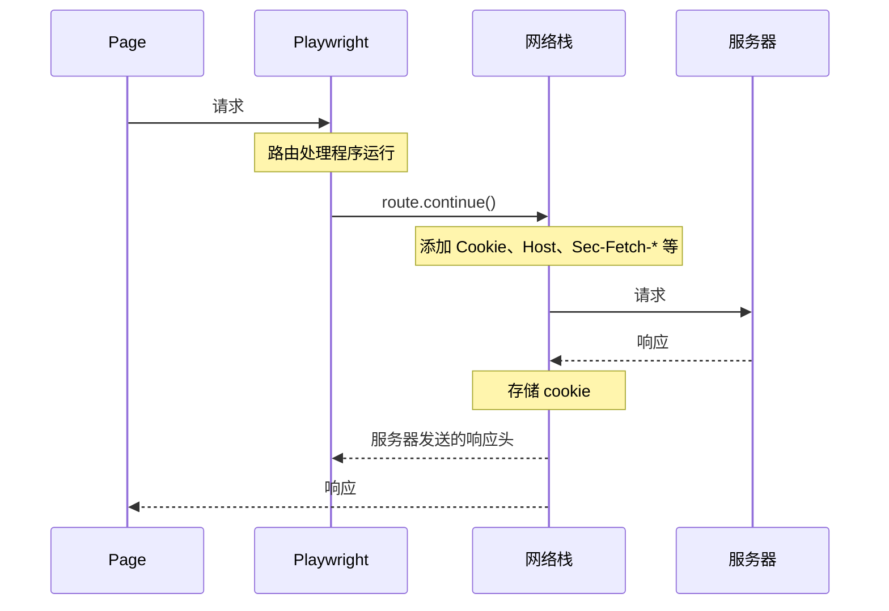

# 网络

## 简介

Playwright 提供 API 来**监控**和**修改**浏览器网络流量，包括 HTTP 和 HTTPS。页面发起的任何请求，包括 [XHR](https://developer.mozilla.org/en-US/docs/Web/API/XMLHttpRequest) 和
[fetch](https://developer.mozilla.org/en-US/docs/Web/API/Fetch_API) 请求，都可以被追踪、修改和处理。

## API 模拟

查看我们的 [API 模拟指南](./mock.md) 了解更多关于如何：
- 模拟 API 请求，完全不访问 API
- 执行 API 请求并修改响应
- 使用 HAR 文件模拟网络请求

## HTTP 认证

执行 HTTP 认证。

```java
BrowserContext context = browser.newContext(new Browser.NewContextOptions()
  .setHttpCredentials("bill", "pa55w0rd"));
Page page = context.newPage();
page.navigate("https://example.com");
```

## HTTP 代理

你可以配置页面通过 HTTP(S) 代理或 SOCKSv5 加载。代理可以为整个浏览器全局设置，也可以为每个浏览器上下文单独设置。

你可以选择性地为 HTTP(S) 代理指定用户名和密码，还可以指定要绕过 [`proxy`](/java/api/class-browser#browser-new-context-option-proxy) 的主机。

以下是全局代理的示例：

```java
Browser browser = chromium.launch(new BrowserType.LaunchOptions()
  .setProxy(new Proxy("http://myproxy.com:3128")
  .setUsername("usr")
  .setPassword("pwd")));
```

也可以为每个上下文单独指定：

```java
Browser browser = chromium.launch();
BrowserContext context = browser.newContext(new Browser.NewContextOptions()
  .setProxy(new Proxy("http://myproxy.com:3128")));
```

## 网络事件

你可以监控所有的 [Request](/java/api/class-request) 和 [Response](/java/api/class-response)：

```java
import com.microsoft.playwright.*;

public class Example {
  public static void main(String[] args) {
    try (Playwright playwright = Playwright.create()) {
      BrowserType chromium = playwright.chromium();
      Browser browser = chromium.launch();
      Page page = browser.newPage();
      page.onRequest(request -> System.out.println(">> " + request.method() + " " + request.url()));
      page.onResponse(response -> System.out.println("<<" + response.status() + " " + response.url()));
      page.navigate("https://example.com");
      browser.close();
    }
  }
}
```

或者使用 [`page.waitForResponse()`](/java/api/class-page#page-wait-for-response) 在按钮点击后等待网络响应：

```java
// 使用 glob URL 模式
Response response = page.waitForResponse("**/api/fetch_data", () -> {
  page.getByText("Update").click();
});
```

#### 变体

使用 [`page.waitForResponse()`](/java/api/class-page#page-wait-for-response) 等待 [Response](/java/api/class-response)

```java
// 使用正则表达式
Response response = page.waitForResponse(Pattern.compile("\\.jpeg$"), () -> {
  page.getByText("Update").click();
});

// 使用接受 Response 对象的断言
Response response = page.waitForResponse(r -> r.url().contains(token), () -> {
  page.getByText("Update").click();
});
```

## 处理请求

```java
page.route("**/api/fetch_data", route -> route.fulfill(new Route.FulfillOptions()
  .setStatus(200)
  .setBody(testData)));
page.navigate("https://example.com");
```

你可以通过在 Playwright 脚本中处理网络请求来模拟 API 端点。

#### 变体

使用 [`browserContext.route()`](/java/api/class-browsercontext#browser-context-route) 在整个浏览器上下文上设置路由，或使用 [`page.route()`](/java/api/class-page#page-route) 在页面上设置。它将应用于弹出窗口和打开的链接。

```java
browserContext.route("**/api/login", route -> route.fulfill(new Route.FulfillOptions()
  .setStatus(200)
  .setBody("accept")));
page.navigate("https://example.com");
```

## 修改请求

```java
// 删除请求头
page.route("**/*", route -> {
  Map<String, String> headers = new HashMap<>(route.request().headers());
  headers.remove("x-secret");
    route.resume(new Route.ResumeOptions().setHeaders(headers));
});

// 将请求继续为 POST 方法。
page.route("**/*", route -> route.resume(new Route.ResumeOptions().setMethod("POST")));
```

你可以对请求进行修改后继续。上面的示例从发出的请求中删除了一个 HTTP 请求头。

## 中止请求

你可以使用 [`page.route()`](/java/api/class-page#page-route) 和 [`route.abort()`](/java/api/class-route#route-abort) 中止请求。

```java
page.route("**/*.{png,jpg,jpeg}", route -> route.abort());

// 根据请求类型中止
page.route("**/*", route -> {
  if ("image".equals(route.request().resourceType()))
    route.abort();
  else
    route.resume();
});
```

## 修改响应

要修改响应，使用 [APIRequestContext](/java/api/class-apirequestcontext) 获取原始响应，然后将响应传递给 [`route.fulfill()`](/java/api/class-route#route-fulfill)。你可以通过选项覆盖响应中的各个字段：

```java
page.route("**/title.html", route -> {
  // 获取原始响应。
  APIResponse response = route.fetch();
  // 为标题添加前缀。
  String body = response.text();
  body = body.replace("<title>", "<title>My prefix:");
  Map<String, String> headers = response.headers();
  headers.put("content-type", "text/html");
  route.fulfill(new Route.FulfillOptions()
    // 传递响应中的所有字段。
    .setResponse(response)
    // 覆盖响应体。
    .setBody(body)
    // 强制内容类型为 html。
    .setHeaders(headers));
});
```

## 请求拦截的工作原理

路由位于页面和浏览器网络栈之间。处理程序在网络栈处理请求之前运行：[`route.resume()`](/java/api/class-route#route-continue) 将请求传递下去，[`route.fulfill()`](/java/api/class-route#route-fulfill) 在不接触网络的情况下响应请求，[`route.abort()`](/java/api/class-route#route-abort) 使请求失败。



### 由网络栈管理的请求头

某些请求头由网络栈在请求发送前附加：`Cookie`、`Host`、`Accept-Encoding`、`Content-Length`、`Sec-Fetch-*` 等。这是一个安全边界：例如，`HttpOnly` cookie 永远不会暴露给页面。由于路由处理程序在该步骤之前运行，这些请求头在 [`request.headers()`](/java/api/class-request#request-headers) 或 [`request.allHeaders()`](/java/api/class-request#request-all-headers) 中不一定存在，并且无法被覆盖。传递给 [`route.resume()`](/java/api/class-route#route-continue) 的 `cookie` 请求头会被忽略，浏览器的 cookie 存储优先。

在响应端，网络栈已经完成了它的工作，所以 [`response.allHeaders()`](/java/api/class-response#response-all-headers) 返回的请求头与服务器发送的完全一致，包括 `HttpOnly` cookie 的 `Set-Cookie`。要查看实际通过网络发送的确切请求头，可以在不路由的情况下观察请求：当没有安装路由时，[`request.allHeaders()`](/java/api/class-request#request-all-headers) 包含所有请求头。

### 重定向

Playwright 将请求及其重定向视为一个单元。处理程序只会为原始请求调用一次，浏览器会自行跟随重定向。[`response.request()`](/java/api/class-response#response-request) 返回链中的最后一个请求，[`request.redirectedFrom()`](/java/api/class-request#request-redirected-from) 可以追溯到你拦截的那个请求。传递给 [`route.resume()`](/java/api/class-route#route-continue) 的请求头适用于链中的每一跳，除了 `cookie`，它总是来自 cookie 存储。

用 `3xx` 状态码完成响应不会给你第二次拦截的机会。Chromium 和 Firefox 会在不调用你的处理程序的情况下跟随重定向，WebKit 会拒绝该调用。要提供不同的内容，直接用该内容完成响应。要将请求发送到其他地方，将 `url` 传递给 [`route.resume()`](/java/api/class-route#route-continue) 或 [`route.fallback()`](/java/api/class-route#route-fallback)。

## Glob URL 模式

Playwright 在网络拦截方法（如 [`page.route()`](/java/api/class-page#page-route) 或 [`page.waitForResponse()`](/java/api/class-page#page-wait-for-response)）中使用简化的 glob 模式进行 URL 匹配。这些模式支持基本的通配符：
1. 星号：
   - 单个 `*` 匹配除 `/` 以外的任何字符
   - 双星 `**` 匹配包括 `/` 在内的任何字符
1. 问号 `?` 只匹配问号 `?`。如果你想匹配任何字符，请使用 `*`。
1. 花括号 `{}` 可用于匹配由逗号 `,` 分隔的选项列表
1. 反斜杠 `\` 可用于转义任何特殊字符（注意反斜杠本身需要转义为 `\\`）

示例：
- `https://example.com/*.js` 匹配 `https://example.com/file.js` 但不匹配 `https://example.com/path/file.js`
- `https://example.com/?page=1` 匹配 `https://example.com/?page=1` 但不匹配 `https://example.com`
- `**/*.js` 同时匹配 `https://example.com/file.js` 和 `https://example.com/path/file.js`
- `**/*.{png,jpg,jpeg}` 匹配所有图片请求

重要说明：
- glob 模式必须匹配整个 URL，而不仅仅是其中一部分。
- 使用 glob 进行 URL 匹配时，要考虑完整的 URL 结构，包括协议和路径分隔符。
- 对于更复杂的匹配需求，考虑使用 [RegExp] 而不是 glob 模式。

## WebSocket

Playwright 开箱即用地支持 [WebSocket](https://developer.mozilla.org/en-US/docs/Web/API/WebSockets_API) 检查、模拟和修改。查看我们的 [API 模拟指南](./mock.md#mock-websockets) 了解如何模拟 WebSocket。

每次创建 WebSocket 时，都会触发 [`page.onWebSocket()`](/java/api/class-page#page-event-web-socket) 事件。此事件包含用于进一步检查 WebSocket 帧的 [WebSocket](/java/api/class-websocket) 实例：

```java
page.onWebSocket(ws -> {
  log("WebSocket 已打开: " + ws.url());
  ws.onFrameSent(frameData -> log(frameData.text()));
  ws.onFrameReceived(frameData -> log(frameData.text()));
  ws.onClose(ws1 -> log("WebSocket 已关闭"));
});
```

## 网络事件丢失和 Service Worker

Playwright 的内置 [`browserContext.route()`](/java/api/class-browsercontext#browser-context-route) 和 [`page.route()`](/java/api/class-page#page-route) 允许你的测试原生路由请求并执行模拟和拦截。

如果你使用 Playwright 的原生 [`browserContext.route()`](/java/api/class-browsercontext#browser-context-route) 和 [`page.route()`](/java/api/class-page#page-route)，但似乎缺少网络事件，请通过将 [`serviceWorkers`](/java/api/class-browser#browser-new-context-option-service-workers) 设置为 `'block'` 来禁用 Service Worker。

可能你正在使用模拟工具，如 Mock Service Worker (MSW)。虽然这个工具可以开箱即用地模拟响应，但它添加了自己的 Service Worker 来接管网络请求，因此使它们对 [`browserContext.route()`](/java/api/class-browsercontext#browser-context-route) 和 [`page.route()`](/java/api/class-page#page-route) 不可见。如果你对网络测试和模拟都感兴趣，考虑使用内置的 [`browserContext.route()`](/java/api/class-browsercontext#browser-context-route) 和 [`page.route()`](/java/api/class-page#page-route) 进行[响应模拟](#处理请求)。
