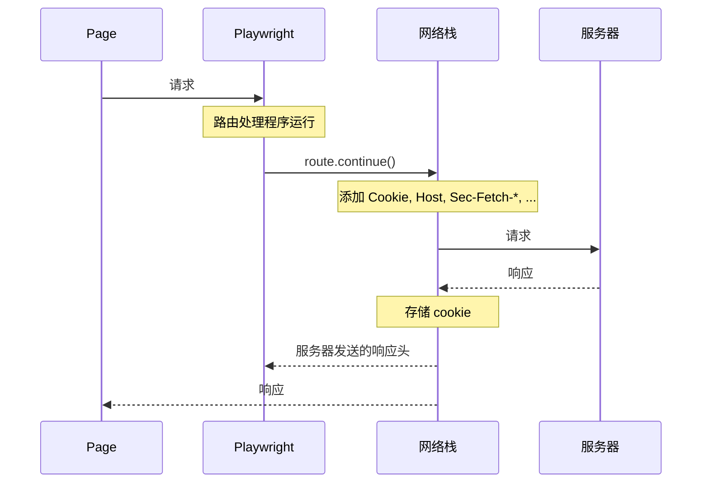

# 网络

## 简介

Playwright 提供 API 来**监控**和**修改**浏览器网络流量，包括 HTTP 和 HTTPS。页面发出的任何请求，包括 [XHR](https://developer.mozilla.org/en-US/docs/Web/API/XMLHttpRequest) 和 [fetch](https://developer.mozilla.org/en-US/docs/Web/API/Fetch_API) 请求，都可以被跟踪、修改和处理。

## Mock API

查看我们的 [API 模拟指南](./mock.md)以了解更多关于如何：
- 模拟 API 请求而不实际调用 API
- 执行 API 请求并修改响应
- 使用 HAR 文件模拟网络请求

## 网络模拟

您无需进行任何配置即可模拟网络请求。只需定义一个自定义 [Route](/api/class-route) 来模拟浏览器上下文的网络。

::: code-group

```js [example.spec.ts]
import { test, expect } from '@playwright/test';

test.beforeEach(async ({ context }) => {
  // 为此文件中的每个测试阻止任何 css 请求。
  await context.route(/.css$/, route => route.abort());
});

test('loads page without css', async ({ page }) => {
  await page.goto('https://playwright.dev');
  // ... 测试代码
});
```

:::

或者，您可以使用 [`page.route()`](/api/class-page#page-route) 在单个页面中模拟网络。

::: code-group

```js [example.spec.ts]
import { test, expect } from '@playwright/test';

test('loads page without images', async ({ page }) => {
  // 阻止 png 和 jpeg 图片。
  await page.route(/(png|jpeg)$/, route => route.abort());

  await page.goto('https://playwright.dev');
  // ... 测试代码
});
```

:::

## HTTP 认证

执行 HTTP 认证。

::: code-group

```js [Test]
import { defineConfig } from '@playwright/test';
export default defineConfig({
  use: {
    httpCredentials: {
      username: 'bill',
      password: 'pa55w0rd',
    }
  }
});
```

```js [Library]
const context = await browser.newContext({
  httpCredentials: {
    username: 'bill',
    password: 'pa55w0rd',
  },
});
const page = await context.newPage();
await page.goto('https://example.com');
```

:::

## HTTP 代理

您可以将页面配置为通过 HTTP(S) 代理或 SOCKSv5 加载。代理可以为整个浏览器全局设置，也可以为每个浏览器上下文单独设置。

您可以选择性地为 HTTP(S) 代理指定用户名和密码，还可以指定要绕过 [`proxy`](/api/class-browser#browser-new-context-option-proxy) 的主机。

以下是全局代理的示例：

::: code-group

```js [Test]
import { defineConfig } from '@playwright/test';
export default defineConfig({
  use: {
    proxy: {
      server: 'http://myproxy.com:3128',
      username: 'usr',
      password: 'pwd'
    }
  }
});
```

```js [Library]
const browser = await chromium.launch({
  proxy: {
    server: 'http://myproxy.com:3128',
    username: 'usr',
    password: 'pwd'
  }
});
```

:::

也可以按上下文指定：

::: code-group

```js [Test]
import { test, expect } from '@playwright/test';

test('should use custom proxy on a new context', async ({ browser }) => {
  const context = await browser.newContext({
    proxy: {
      server: 'http://myproxy.com:3128',
    }
  });
  const page = await context.newPage();

  await context.close();
});
```

```js [Library]
const browser = await chromium.launch();
const context = await browser.newContext({
  proxy: { server: 'http://myproxy.com:3128' }
});
```

:::

## 网络事件

您可以监控所有 [Request](/api/class-request) 和 [Response](/api/class-response)：

```js
// 订阅 'request' 和 'response' 事件。
page.on('request', request => console.log('>>', request.method(), request.url()));
page.on('response', response => console.log('<<', response.status(), response.url()));

await page.goto('https://example.com');
```

或者使用 [`page.waitForResponse()`](/api/class-page#page-wait-for-response) 在按钮点击后等待网络响应：

```js
// 使用 glob URL 模式。注意没有 await。
const responsePromise = page.waitForResponse('**/api/fetch_data');
await page.getByText('Update').click();
const response = await responsePromise;
```

#### 变体

使用 [`page.waitForResponse()`](/api/class-page#page-wait-for-response) 等待 [Response](/api/class-response)

```js
// 使用正则表达式。注意没有 await。
const responsePromise = page.waitForResponse(/\.jpeg$/);
await page.getByText('Update').click();
const response = await responsePromise;

// 使用接收 Response 对象的谓词函数。注意没有 await。
const responsePromise = page.waitForResponse(response => response.url().includes(token));
await page.getByText('Update').click();
const response = await responsePromise;
```

## 处理请求

```js
await page.route('**/api/fetch_data', route => route.fulfill({
  status: 200,
  body: testData,
}));
await page.goto('https://example.com');
```

您可以通过在 Playwright 脚本中处理网络请求来模拟 API 端点。

#### 变体

使用 [`browserContext.route()`](/api/class-browsercontext#browser-context-route) 在整个浏览器上下文上设置路由，或使用 [`page.route()`](/api/class-page#page-route) 在页面上设置。它将应用于弹出窗口和打开的链接。

```js
await browserContext.route('**/api/login', route => route.fulfill({
  status: 200,
  body: 'accept',
}));
await page.goto('https://example.com');
```

## 修改请求

```js
// 删除请求头
await page.route('**/*', async route => {
  const headers = route.request().headers();
  delete headers['x-secret'];
  await route.continue({ headers });
});

// 将请求继续为 POST。
await page.route('**/*', route => route.continue({ method: 'POST' }));
```

您可以带修改地继续请求。上面的示例从传出请求中删除了一个 HTTP 头。

## 中止请求

您可以使用 [`page.route()`](/api/class-page#page-route) 和 [`route.abort()`](/api/class-route#route-abort) 中止请求。

```js
await page.route('**/*.{png,jpg,jpeg}', route => route.abort());

// 根据请求类型中止
await page.route('**/*', route => {
  return route.request().resourceType() === 'image' ? route.abort() : route.continue();
});
```

## 修改响应

要修改响应，请使用 [APIRequestContext](/api/class-apirequestcontext) 获取原始响应，然后将响应传递给 [`route.fulfill()`](/api/class-route#route-fulfill)。您可以通过选项覆盖响应上的各个字段：

```js
await page.route('**/title.html', async route => {
  // 获取原始响应。
  const response = await route.fetch();
  // 为标题添加前缀。
  let body = await response.text();
  body = body.replace('<title>', '<title>My prefix:');
  await route.fulfill({
    // 传递响应的所有字段。
    response,
    // 覆盖响应体。
    body,
    // 强制内容类型为 html。
    headers: {
      ...response.headers(),
      'content-type': 'text/html'
    }
  });
});
```

## 请求拦截的工作原理

路由位于页面和浏览器网络栈之间。处理程序在网络栈处理请求之前运行：[`route.continue()`](/api/class-route#route-continue) 将其传递下去，[`route.fulfill()`](/api/class-route#route-fulfill) 在不接触网络的情况下响应它，[`route.abort()`](/api/class-route#route-abort) 使其失败。



### 网络栈拥有的头

某些头是在请求发送前由网络栈附加的：`Cookie`、`Host`、`Accept-Encoding`、`Content-Length`、`Sec-Fetch-*` 等。这是一个安全边界：例如，`HttpOnly` cookie 永远不会暴露给页面。由于路由处理程序在该步骤之前运行，这些头在 [`request.headers()`](/api/class-request#request-headers) 或 [`request.allHeaders()`](/api/class-request#request-all-headers) 中可能不可靠地存在，且无法覆盖它们。传递给 [`route.continue()`](/api/class-route#route-continue) 的 `cookie` 头会被忽略，以浏览器的 cookie 存储为准。

在响应端，网络栈已经完成了它的工作，因此 [`response.allHeaders()`](/api/class-response#response-all-headers) 返回服务器发送的完全相同的头，包括 `HttpOnly` cookie 的 `Set-Cookie`。要查看通过网络发送的确切请求头，请在不路由的情况下观察请求：在没有安装路由的情况下，[`request.allHeaders()`](/api/class-request#request-all-headers) 包含所有头。

### 重定向

Playwright 将请求及其重定向视为一个单元。处理程序只调用一次，针对原始请求，浏览器自行跟随重定向。[`response.request()`](/api/class-response#response-request) 返回链中的最后一个请求，[`request.redirectedFrom()`](/api/class-request#request-redirected-from) 可以追溯到您拦截的那个请求。传递给 [`route.continue()`](/api/class-route#route-continue) 的头适用于链的每一跳，除了 `cookie`，它始终来自 cookie 存储。

使用 `3xx` 状态码完成不会给您第二次拦截的机会。Chromium 和 Firefox 在不调用您的处理程序的情况下跟随重定向，WebKit 则拒绝该调用。要提供不同的内容，请用该内容完成。要将请求发送到其他地方，请将 `url` 传递给 [`route.continue()`](/api/class-route#route-continue) 或 [`route.fallback()`](/api/class-route#route-fallback)。

## Glob URL 模式

Playwright 在网络拦截方法（如 [`page.route()`](/api/class-page#page-route) 或 [`page.waitForResponse()`](/api/class-page#page-wait-for-response)）中使用简化的 glob 模式进行 URL 匹配。这些模式支持基本通配符：
1. 星号：
   - 单个 `*` 匹配除 `/` 以外的任何字符
   - 双星 `**` 匹配包括 `/` 在内的任何字符
1. 问号 `?` 只匹配问号 `?`。如果您想匹配任何字符，请改用 `*`。
1. 花括号 `{}` 可用于匹配由逗号 `,` 分隔的选项列表
1. 反斜杠 `\` 可用于转义任何特殊字符（注意将反斜杠本身转义为 `\\`）

示例：
- `https://example.com/*.js` 匹配 `https://example.com/file.js` 但不匹配 `https://example.com/path/file.js`
- `https://example.com/?page=1` 匹配 `https://example.com/?page=1` 但不匹配 `https://example.com`
- `**/*.js` 同时匹配 `https://example.com/file.js` 和 `https://example.com/path/file.js`
- `**/*.{png,jpg,jpeg}` 匹配所有图片请求

重要说明：
- glob 模式必须匹配整个 URL，而不仅仅是其中的一部分。
- 使用 glob 进行 URL 匹配时，请考虑完整的 URL 结构，包括协议和路径分隔符。
- 对于更复杂的匹配要求，请考虑使用 [RegExp] 而不是 glob 模式。

## WebSockets

Playwright 开箱即用地支持 [WebSockets](https://developer.mozilla.org/en-US/docs/Web/API/WebSockets_API) 检查、模拟和修改。请参阅我们的 [API 模拟指南](./mock.md#mock-websockets) 以了解如何模拟 WebSockets。

每次创建 WebSocket 时，都会触发 [`page.on('webSocket')`](/api/class-page#page-event-web-socket) 事件。此事件包含用于进一步检查 Web Socket 帧的 [WebSocket](/api/class-websocket) 实例：

```js
page.on('websocket', ws => {
  console.log(`WebSocket 已打开: ${ws.url()}>`);
  ws.on('framesent', event => console.log(event.payload));
  ws.on('framereceived', event => console.log(event.payload));
  ws.on('close', () => console.log('WebSocket 已关闭'));
});
```

## 缺失的网络事件和 Service Workers

Playwright 的内置 [`browserContext.route()`](/api/class-browsercontext#browser-context-route) 和 [`page.route()`](/api/class-page#page-route) 允许您的测试原生路由请求并执行模拟和拦截。

如果您使用 Playwright 的原生 [`browserContext.route()`](/api/class-browsercontext#browser-context-route) 和 [`page.route()`](/api/class-page#page-route)，并且发现网络事件丢失，请通过将 [`serviceWorkers`](/api/class-browser#browser-new-context-option-service-workers) 设置为 `'block'` 来禁用 Service Workers。

您可能正在使用像 Mock Service Worker (MSW) 这样的模拟工具。虽然此工具可以开箱即用地模拟响应，但它添加了自己的 Service Worker 来接管网络请求，从而使它们对 [`browserContext.route()`](/api/class-browsercontext#browser-context-route) 和 [`page.route()`](/api/class-page#page-route) 不可见。如果您对网络测试和模拟都感兴趣，请考虑使用内置的 [`browserContext.route()`](/api/class-browsercontext#browser-context-route) 和 [`page.route()`](/api/class-page#page-route) 进行[响应模拟](#处理请求)。

###### 
如果您不仅对使用 Service Workers 进行测试和网络模拟感兴趣，还想路由和监听 Service Workers 本身发出的请求，请参阅[此指南](./service-workers.md)。
