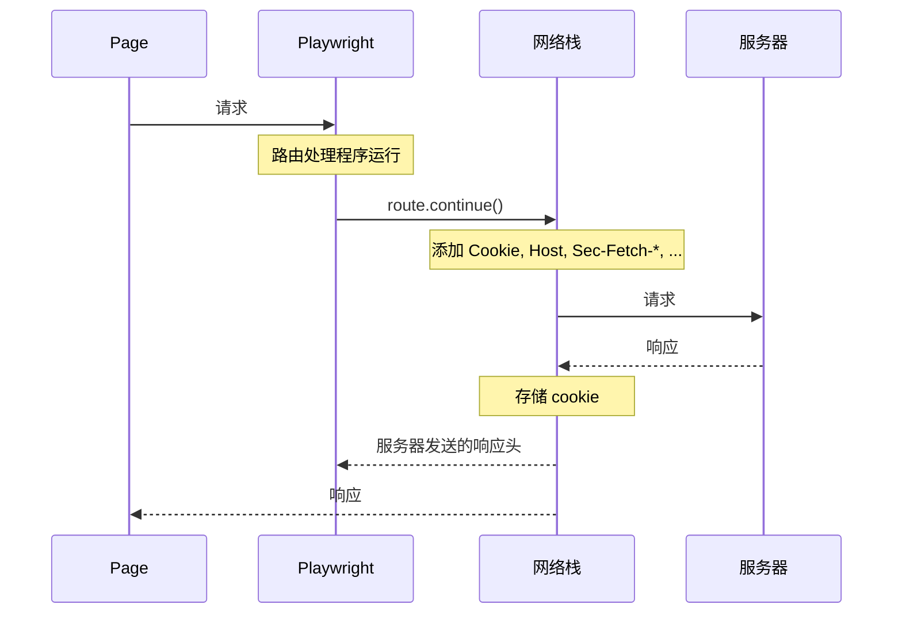

# 网络

## 简介

Playwright 提供 API 来**监控**和**修改**浏览器网络流量，包括 HTTP 和 HTTPS。页面发出的任何请求，包括 [XHR](https://developer.mozilla.org/en-US/docs/Web/API/XMLHttpRequest) 和 [fetch](https://developer.mozilla.org/en-US/docs/Web/API/Fetch_API) 请求，都可以被追踪、修改和处理。

## 模拟 API

查看我们的 [API 模拟指南](./mock.md)，了解更多关于如何：
- 模拟 API 请求，不访问真实 API
- 执行 API 请求并修改响应
- 使用 HAR 文件模拟网络请求

## HTTP 认证

执行 HTTP 认证。

::: code-group

```python [Async]
context = await browser.new_context(
    http_credentials={"username": "bill", "password": "pa55w0rd"}
)
page = await context.new_page()
await page.goto("https://example.com")
```

```python [Sync]
context = browser.new_context(
    http_credentials={"username": "bill", "password": "pa55w0rd"}
)
page = context.new_page()
page.goto("https://example.com")
```

:::

## HTTP 代理

你可以配置页面通过 HTTP(S) 代理或 SOCKSv5 加载。代理可以全局设置在整个浏览器上，也可以为每个浏览器上下文单独设置。

你可以选择性地为 HTTP(S) 代理指定用户名和密码，还可以指定绕过 [`proxy`](/python/api/class-browser#browser-new-context-option-proxy) 的主机。

以下是全局代理的示例：

::: code-group

```python [Async]
browser = await chromium.launch(proxy={
  "server": "http://myproxy.com:3128",
  "username": "usr",
  "password": "pwd"
})
```

```python [Sync]
browser = chromium.launch(proxy={
  "server": "http://myproxy.com:3128",
  "username": "usr",
  "password": "pwd"
})
```

:::

也可以为每个上下文单独指定：

::: code-group

```python [Async]
browser = await chromium.launch()
context = await browser.new_context(proxy={"server": "http://myproxy.com:3128"})
```

```python [Sync]
browser = chromium.launch()
context = browser.new_context(proxy={"server": "http://myproxy.com:3128"})
```

:::

## 网络事件

你可以监控所有的 [Request](/python/api/class-request) 和 [Response](/python/api/class-response)：

::: code-group

```python [Async]
import asyncio
from playwright.async_api import async_playwright, Playwright

async def run(playwright: Playwright):
    chromium = playwright.chromium
    browser = await chromium.launch()
    page = await browser.new_page()
    # 订阅 "request" 和 "response" 事件。
    page.on("request", lambda request: print(">>", request.method, request.url))
    page.on("response", lambda response: print("<<", response.status, response.url))
    await page.goto("https://example.com")
    await browser.close()

async def main():
    async with async_playwright() as playwright:
        await run(playwright)
asyncio.run(main())
```

```python [Sync]
from playwright.sync_api import sync_playwright, Playwright

def run(playwright: Playwright):
    chromium = playwright.chromium
    browser = chromium.launch()
    page = browser.new_page()
    # 订阅 "request" 和 "response" 事件。
    page.on("request", lambda request: print(">>", request.method, request.url))
    page.on("response", lambda response: print("<<", response.status, response.url))
    page.goto("https://example.com")
    browser.close()

with sync_playwright() as playwright:
    run(playwright)
```

:::

或者使用 [`page.expect_response()`](/python/api/class-page#page-wait-for-response) 在按钮点击后等待网络响应：

::: code-group

```python [Async]
# 使用 glob URL 模式
async with page.expect_response("**/api/fetch_data") as response_info:
    await page.get_by_text("Update").click()
response = await response_info.value
```

```python [Sync]
# 使用 glob URL 模式
with page.expect_response("**/api/fetch_data") as response_info:
    page.get_by_text("Update").click()
response = response_info.value
```

:::

#### 变体

使用 [`page.expect_response()`](/python/api/class-page#page-wait-for-response) 等待 [Response](/python/api/class-response)

::: code-group

```python [Async]
# 使用正则表达式
async with page.expect_response(re.compile(r"\.jpeg$")) as response_info:
    await page.get_by_text("Update").click()
response = await response_info.value

# 使用接收响应对象的谓词函数
async with page.expect_response(lambda response: token in response.url) as response_info:
    await page.get_by_text("Update").click()
response = await response_info.value
```

```python [Sync]
# 使用正则表达式
with page.expect_response(re.compile(r"\.jpeg$")) as response_info:
    page.get_by_text("Update").click()
response = response_info.value

# 使用接收响应对象的谓词函数
with page.expect_response(lambda response: token in response.url) as response_info:
    page.get_by_text("Update").click()
response = response_info.value
```

:::

## 处理请求

::: code-group

```python [Async]
await page.route(
    "**/api/fetch_data",
    lambda route: route.fulfill(status=200, body=test_data))
await page.goto("https://example.com")
```

```python [Sync]
page.route(
    "**/api/fetch_data",
    lambda route: route.fulfill(status=200, body=test_data))
page.goto("https://example.com")
```

:::

你可以通过在 Playwright 脚本中处理网络请求来模拟 API 端点。

#### 变体

使用 [`browser_context.route()`](/python/api/class-browsercontext#browser-context-route) 在整个浏览器上下文上设置路由，或使用 [`page.route()`](/python/api/class-page#page-route) 在页面上设置路由。它将应用于弹出窗口和打开的链接。

::: code-group

```python [Async]
await context.route(
    "**/api/login",
    lambda route: route.fulfill(status=200, body="accept"))
await page.goto("https://example.com")
```

```python [Sync]
context.route(
    "**/api/login",
    lambda route: route.fulfill(status=200, body="accept"))
page.goto("https://example.com")
```

:::

## 修改请求

::: code-group

```python [Async]
# 删除请求头
async def handle_route(route):
    headers = route.request.headers
    del headers["x-secret"]
    await route.continue_(headers=headers)
await page.route("**/*", handle_route)

# 将请求继续为 POST 方法。
await page.route("**/*", lambda route: route.continue_(method="POST"))
```

```python [Sync]
# 删除请求头
def handle_route(route):
    headers = route.request.headers
    del headers["x-secret"]
    route.continue_(headers=headers)
page.route("**/*", handle_route)

# 将请求继续为 POST 方法。
page.route("**/*", lambda route: route.continue_(method="POST"))
```

:::

你可以带修改地继续请求。上面的示例从出站请求中删除了一个 HTTP 头。

## 中止请求

你可以使用 [`page.route()`](/python/api/class-page#page-route) 和 [`route.abort()`](/python/api/class-route#route-abort) 中止请求。

::: code-group

```python [Async]
await page.route("**/*.{png,jpg,jpeg}", lambda route: route.abort())

# 根据请求类型中止
await page.route("**/*", lambda route: route.abort() if route.request.resource_type == "image"  else route.continue_())
```

```python [Sync]
page.route("**/*.{png,jpg,jpeg}", lambda route: route.abort())

# 根据请求类型中止
page.route("**/*", lambda route: route.abort() if route.request.resource_type == "image"  else route.continue_())
```

:::

## 修改响应

要修改响应，请使用 [APIRequestContext](/python/api/class-apirequestcontext) 获取原始响应，然后将响应传递给 [`route.fulfill()`](/python/api/class-route#route-fulfill)。你可以通过选项覆盖响应中的各个字段：

::: code-group

```python [Async]
async def handle_route(route: Route) -> None:
    # 获取原始响应。
    response = await route.fetch()
    # 为标题添加前缀。
    body = await response.text()
    body = body.replace("<title>", "<title>My prefix:")
    await route.fulfill(
        # 传递响应的所有字段。
        response=response,
        # 覆盖响应体。
        body=body,
        # 强制内容类型为 html。
        headers={**response.headers, "content-type": "text/html"},
    )

await page.route("**/title.html", handle_route)
```

```python [Sync]
def handle_route(route: Route) -> None:
    # 获取原始响应。
    response = route.fetch()
    # 为标题添加前缀。
    body = response.text()
    body = body.replace("<title>", "<title>My prefix:")
    route.fulfill(
        # 传递响应的所有字段。
        response=response,
        # 覆盖响应体。
        body=body,
        # 强制内容类型为 html。
        headers={**response.headers, "content-type": "text/html"},
    )

page.route("**/title.html", handle_route)
```

:::

## 请求拦截的工作原理

路由位于页面和浏览器网络栈之间。处理程序在网络栈处理请求之前运行：[`route.continue_()`](/python/api/class-route#route-continue) 将请求传递下去，[`route.fulfill()`](/python/api/class-route#route-fulfill) 在不触及网络的情况下响应请求，[`route.abort()`](/python/api/class-route#route-abort) 使请求失败。



### 由网络栈管理的请求头

某些请求头在请求发送前由网络栈附加：`Cookie`、`Host`、`Accept-Encoding`、`Content-Length`、`Sec-Fetch-*` 等。这是一个安全边界：例如，`HttpOnly` cookie 永远不会暴露给页面。由于路由处理程序在该步骤之前运行，这些请求头在 [`request.headers()`](/python/api/class-request#request-headers) 或 [`request.all_headers()`](/python/api/class-request#request-all-headers) 中不能可靠地存在，也不能被覆盖。传递给 [`route.continue_()`](/python/api/class-route#route-continue) 的 `cookie` 请求头会被忽略，以支持浏览器的 cookie 存储。

在响应端，网络栈已经完成了它的工作，所以 [`response.all_headers()`](/python/api/class-response#response-all-headers) 返回的请求头与服务器发送的完全一致，包括 `HttpOnly` cookie 的 `Set-Cookie`。要查看实际通过网络传输的请求头，可以在不路由请求的情况下观察它：在没有安装路由的情况下，[`request.all_headers()`](/python/api/class-request#request-all-headers) 包含所有请求头。

### 重定向

Playwright 将请求及其重定向视为一个单元。处理程序只为原始请求调用一次，浏览器自行跟随重定向。[`response.request()`](/python/api/class-response#response-request) 返回链中的最后一个请求，[`request.redirected_from()`](/python/api/class-request#request-redirected-from) 可以追溯到你拦截的那个请求。传递给 [`route.continue_()`](/python/api/class-route#route-continue) 的请求头应用于链的每一跳，除了 `cookie`，它始终来自 cookie 存储。

使用 `3xx` 状态完成不会给你第二次拦截的机会。Chromium 和 Firefox 在不调用你的处理程序的情况下跟随重定向，WebKit 会拒绝该调用。要提供不同的内容，请直接用该内容完成。要将请求发送到其他地方，请将 `url` 传递给 [`route.continue_()`](/python/api/class-route#route-continue) 或 [`route.fallback()`](/python/api/class-route#route-fallback)。

## Glob URL 模式

Playwright 在网络拦截方法（如 [`page.route()`](/python/api/class-page#page-route) 或 [`page.expect_response()`](/python/api/class-page#page-wait-for-response)）中使用简化的 glob 模式进行 URL 匹配。这些模式支持基本的通配符：
1. 星号：
   - 单个 `*` 匹配除 `/` 之外的任何字符
   - 双星号 `**` 匹配包括 `/` 在内的任何字符
1. 问号 `?` 只匹配问号 `?`。如果你想匹配任意字符，请使用 `*`。
1. 花括号 `{}` 可用于匹配以逗号 `,` 分隔的选项列表
1. 反斜杠 `\` 可用于转义任何特殊字符（注意反斜杠本身转义为 `\\`）

示例：
- `https://example.com/*.js` 匹配 `https://example.com/file.js` 但不匹配 `https://example.com/path/file.js`
- `https://example.com/?page=1` 匹配 `https://example.com/?page=1` 但不匹配 `https://example.com`
- `**/*.js` 同时匹配 `https://example.com/file.js` 和 `https://example.com/path/file.js`
- `**/*.{png,jpg,jpeg}` 匹配所有图片请求

重要说明：
- glob 模式必须匹配整个 URL，而不仅仅是其中的一部分。
- 使用 glob 进行 URL 匹配时，请考虑完整的 URL 结构，包括协议和路径分隔符。
- 对于更复杂的匹配需求，考虑使用 [RegExp] 代替 glob 模式。

## WebSocket

Playwright 开箱即用地支持 [WebSocket](https://developer.mozilla.org/en-US/docs/Web/API/WebSockets_API) 检查、模拟和修改。请参阅我们的 [API 模拟指南](./mock.md#mock-websockets)了解如何模拟 WebSocket。

每次创建 WebSocket 时，都会触发 [`page.on("webSocket")`](/python/api/class-page#page-event-web-socket) 事件。此事件包含用于进一步检查 WebSocket 帧的 [WebSocket](/python/api/class-websocket) 实例：

```python
def on_web_socket(ws):
    print(f"WebSocket 已打开: {ws.url}")
    ws.on("framesent", lambda payload: print(payload))
    ws.on("framereceived", lambda payload: print(payload))
    ws.on("close", lambda payload: print("WebSocket 已关闭"))

page.on("websocket", on_web_socket)
```

## 缺失的网络事件和 Service Worker

Playwright 内置的 [`browser_context.route()`](/python/api/class-browsercontext#browser-context-route) 和 [`page.route()`](/python/api/class-page#page-route) 允许你的测试原生地路由请求并执行模拟和拦截。

如果你正在使用 Playwright 原生的 [`browser_context.route()`](/python/api/class-browsercontext#browser-context-route) 和 [`page.route()`](/python/api/class-page#page-route)，但发现网络事件丢失，请通过将 [`service_workers`](/python/api/class-browser#browser-new-context-option-service-workers) 设置为 `'block'` 来禁用 Service Worker。

可能是你正在使用模拟工具，如 Mock Service Worker (MSW)。虽然这个工具开箱即用地支持模拟响应，但它添加了自己的 Service Worker 来接管网络请求，因此使它们对 [`browser_context.route()`](/python/api/class-browsercontext#browser-context-route) 和 [`page.route()`](/python/api/class-page#page-route) 不可见。如果你对网络测试和模拟都感兴趣，请考虑使用内置的 [`browser_context.route()`](/python/api/class-browsercontext#browser-context-route) 和 [`page.route()`](/python/api/class-page#page-route) 进行[响应模拟](#处理请求)。
