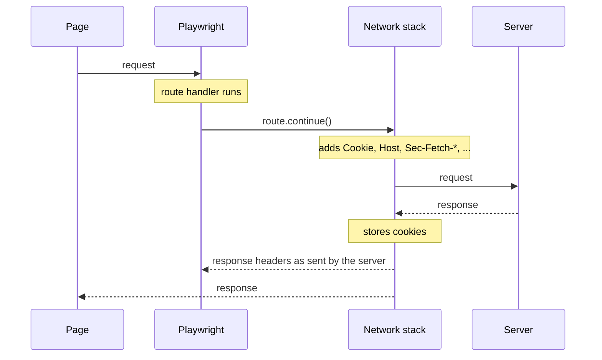

# Network

## Introduction

Playwright provides APIs to **monitor** and **modify** browser network traffic, both HTTP and HTTPS. Any requests that a page does, including [XHRs](https://developer.mozilla.org/en-US/docs/Web/API/XMLHttpRequest) and
[fetch](https://developer.mozilla.org/en-US/docs/Web/API/Fetch_API) requests, can be tracked, modified and handled.

## Mock APIs

Check out our [API mocking guide](./mock.md) to learn more on how to
- mock API requests and never hit the API
- perform the API request and modify the response
- use HAR files to mock network requests.

## HTTP Authentication

Perform HTTP Authentication.

```java
BrowserContext context = browser.newContext(new Browser.NewContextOptions()
  .setHttpCredentials("bill", "pa55w0rd"));
Page page = context.newPage();
page.navigate("https://example.com");
```

## HTTP Proxy

You can configure pages to load over the HTTP(S) proxy or SOCKSv5. Proxy can be either set globally
for the entire browser, or for each browser context individually.

You can optionally specify username and password for HTTP(S) proxy, you can also specify hosts to bypass the [`proxy`](/java/api/class-browser#browser-new-context-option-proxy) for.

Here is an example of a global proxy:

```java
Browser browser = chromium.launch(new BrowserType.LaunchOptions()
  .setProxy(new Proxy("http://myproxy.com:3128")
  .setUsername("usr")
  .setPassword("pwd")));
```

Its also possible to specify it per context:

```java
Browser browser = chromium.launch();
BrowserContext context = browser.newContext(new Browser.NewContextOptions()
  .setProxy(new Proxy("http://myproxy.com:3128")));
```

## Network events

You can monitor all the [Request](/java/api/class-request)s and [Response](/java/api/class-response)s:

```java
import com.microsoft.playwright.*;

public class Example {
  public static void main(String[] args) {
    try (Playwright playwright = Playwright.create()) {
      BrowserType chromium = playwright.chromium();
      Browser browser = chromium.launch();
      Page page = browser.newPage();
      page.onRequest(request -> System.out.println(">> " + request.method() + " " + request.url()));
      page.onResponse(response -> System.out.println("<<" + response.status() + " " + response.url()));
      page.navigate("https://example.com");
      browser.close();
    }
  }
}
```

Or wait for a network response after the button click with [`page.waitForResponse()`](/java/api/class-page#page-wait-for-response):

```java
// Use a glob URL pattern
Response response = page.waitForResponse("**/api/fetch_data", () -> {
  page.getByText("Update").click();
});
```

#### Variations

Wait for [Response](/java/api/class-response)s with [`page.waitForResponse()`](/java/api/class-page#page-wait-for-response)

```java
// Use a RegExp
Response response = page.waitForResponse(Pattern.compile("\\.jpeg$"), () -> {
  page.getByText("Update").click();
});

// Use a predicate taking a Response object
Response response = page.waitForResponse(r -> r.url().contains(token), () -> {
  page.getByText("Update").click();
});
```

## Handle requests

```java
page.route("**/api/fetch_data", route -> route.fulfill(new Route.FulfillOptions()
  .setStatus(200)
  .setBody(testData)));
page.navigate("https://example.com");
```

You can mock API endpoints via handling the network requests in your Playwright script.

#### Variations

Set up route on the entire browser context with [`browserContext.route()`](/java/api/class-browsercontext#browser-context-route) or page with [`page.route()`](/java/api/class-page#page-route). It will apply to popup windows and opened links.

```java
browserContext.route("**/api/login", route -> route.fulfill(new Route.FulfillOptions()
  .setStatus(200)
  .setBody("accept")));
page.navigate("https://example.com");
```

## Modify requests

```java
// Delete header
page.route("**/*", route -> {
  Map<String, String> headers = new HashMap<>(route.request().headers());
  headers.remove("x-secret");
    route.resume(new Route.ResumeOptions().setHeaders(headers));
});

// Continue requests as POST.
page.route("**/*", route -> route.resume(new Route.ResumeOptions().setMethod("POST")));
```

You can continue requests with modifications. Example above removes an HTTP header from the outgoing requests.

## Abort requests

You can abort requests using [`page.route()`](/java/api/class-page#page-route) and [`route.abort()`](/java/api/class-route#route-abort).

```java
page.route("**/*.{png,jpg,jpeg}", route -> route.abort());

// Abort based on the request type
page.route("**/*", route -> {
  if ("image".equals(route.request().resourceType()))
    route.abort();
  else
    route.resume();
});
```

## Modify responses

To modify a response use [APIRequestContext](/java/api/class-apirequestcontext) to get the original response and then pass the response to [`route.fulfill()`](/java/api/class-route#route-fulfill). You can override individual fields on the response via options:

```java
page.route("**/title.html", route -> {
  // Fetch original response.
  APIResponse response = route.fetch();
  // Add a prefix to the title.
  String body = response.text();
  body = body.replace("<title>", "<title>My prefix:");
  Map<String, String> headers = response.headers();
  headers.put("content-type", "text/html");
  route.fulfill(new Route.FulfillOptions()
    // Pass all fields from the response.
    .setResponse(response)
    // Override response body.
    .setBody(body)
    // Force content type to be html.
    .setHeaders(headers));
});
```

## How request interception works

Routes sit between the page and the browser's network stack. The handler runs before the network stack has processed the request: [`route.resume()`](/java/api/class-route#route-continue) passes it on, [`route.fulfill()`](/java/api/class-route#route-fulfill) answers it without touching the network, and [`route.abort()`](/java/api/class-route#route-abort) fails it.



### Headers owned by the network stack

Some headers are attached by the network stack right before the request is sent: `Cookie`, `Host`, `Accept-Encoding`, `Content-Length`, `Sec-Fetch-*` and a few others. This is a security boundary: an `HttpOnly` cookie, for example, is never exposed to the page. Since the route handler runs before that step, these headers are not reliably present in [`request.headers()`](/java/api/class-request#request-headers) or [`request.allHeaders()`](/java/api/class-request#request-all-headers), and they cannot be overridden. A `cookie` header passed to [`route.resume()`](/java/api/class-route#route-continue) is ignored in favor of the browser's cookie store.

On the response side the network stack has already done its work, so [`response.allHeaders()`](/java/api/class-response#response-all-headers) returns the headers exactly as the server sent them, including `Set-Cookie` for `HttpOnly` cookies. To see the exact request headers that went over the wire, observe the request without routing it: with no routes installed, [`request.allHeaders()`](/java/api/class-request#request-all-headers) includes all of them.

### Redirects

Playwright treats a request and its redirects as a single unit. The handler is called once, for the original request, and the browser follows the redirect on its own. [`response.request()`](/java/api/class-response#response-request) returns the last request in the chain, and [`request.redirectedFrom()`](/java/api/class-request#request-redirected-from) walks it back to the one you intercepted. Headers passed to [`route.resume()`](/java/api/class-route#route-continue) apply to every hop of the chain, except `cookie`, which always comes from the cookie store.

Fulfilling with a `3xx` status does not give you a second chance to intercept. Chromium and Firefox follow the redirect without calling your handler, and WebKit rejects the call. To serve different content, fulfill with that content. To send the request elsewhere, pass `url` to [`route.resume()`](/java/api/class-route#route-continue) or [`route.fallback()`](/java/api/class-route#route-fallback).

## Glob URL patterns

Playwright uses simplified glob patterns for URL matching in network interception methods like [`page.route()`](/java/api/class-page#page-route) or [`page.waitForResponse()`](/java/api/class-page#page-wait-for-response). These patterns support basic wildcards:
1. Asterisks:
   - A single `*` matches any characters except `/`
   - A double `**` matches any characters including `/`
1. Question mark `?` matches only question mark `?`. If you want to match any character, use `*` instead.
1. Curly braces `{}` can be used to match a list of options separated by commas `,`
1. Backslash `\` can be used to escape any of special characters (note to escape backslash itself as `\\`)

Examples:
- `https://example.com/*.js` matches `https://example.com/file.js` but not `https://example.com/path/file.js`
- `https://example.com/?page=1` matches `https://example.com/?page=1` but not `https://example.com`
- `**/*.js` matches both `https://example.com/file.js` and `https://example.com/path/file.js`
- `**/*.{png,jpg,jpeg}` matches all image requests

Important notes:
- The glob pattern must match the entire URL, not just a part of it.
- When using globs for URL matching, consider the full URL structure, including the protocol and path separators.
- For more complex matching requirements, consider using [RegExp] instead of glob patterns.

## WebSockets

Playwright supports [WebSockets](https://developer.mozilla.org/en-US/docs/Web/API/WebSockets_API) inspection, mocking and modifying out of the box. See our [API mocking guide](./mock.md#mock-websockets) to learn how to mock WebSockets.

Every time a WebSocket is created, the [`page.onWebSocket()`](/java/api/class-page#page-event-web-socket) event is fired. This event contains the [WebSocket](/java/api/class-websocket) instance for further web socket frames inspection:

```java
page.onWebSocket(ws -> {
  log("WebSocket opened: " + ws.url());
  ws.onFrameSent(frameData -> log(frameData.text()));
  ws.onFrameReceived(frameData -> log(frameData.text()));
  ws.onClose(ws1 -> log("WebSocket closed"));
});
```

## Missing Network Events and Service Workers

Playwright's built-in [`browserContext.route()`](/java/api/class-browsercontext#browser-context-route) and [`page.route()`](/java/api/class-page#page-route) allow your tests to natively route requests and perform mocking and interception.

If you're using Playwright's native [`browserContext.route()`](/java/api/class-browsercontext#browser-context-route) and [`page.route()`](/java/api/class-page#page-route), and it appears network events are missing, disable Service Workers by setting [`serviceWorkers`](/java/api/class-browser#browser-new-context-option-service-workers) to `'block'`.

It might be that you are using a mock tool such as Mock Service Worker (MSW). While this tool works out of the box for mocking responses, it adds its own Service Worker that takes over the network requests, hence making them invisible to [`browserContext.route()`](/java/api/class-browsercontext#browser-context-route) and [`page.route()`](/java/api/class-page#page-route). If you are interested in both network testing and mocking, consider using built-in [`browserContext.route()`](/java/api/class-browsercontext#browser-context-route) and [`page.route()`](/java/api/class-page#page-route) for [response mocking](#handle-requests).
