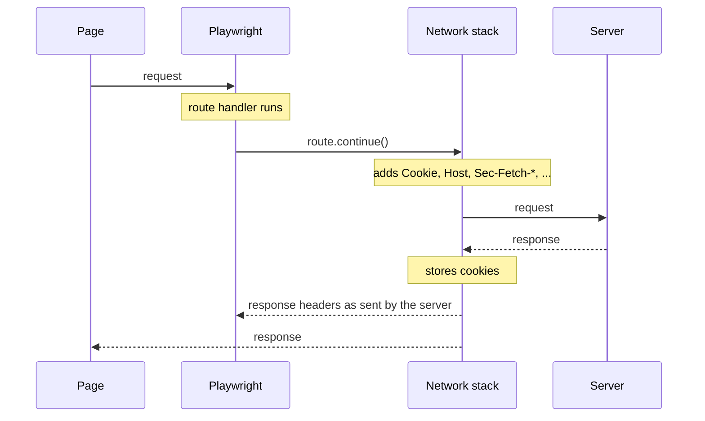

# Network

## Introduction

Playwright provides APIs to **monitor** and **modify** browser network traffic, both HTTP and HTTPS. Any requests that a page does, including [XHRs](https://developer.mozilla.org/en-US/docs/Web/API/XMLHttpRequest) and
[fetch](https://developer.mozilla.org/en-US/docs/Web/API/Fetch_API) requests, can be tracked, modified and handled.

## Mock APIs

Check out our [API mocking guide](./mock.md) to learn more on how to
- mock API requests and never hit the API
- perform the API request and modify the response
- use HAR files to mock network requests.

## HTTP Authentication

Perform HTTP Authentication.

::: code-group

```python [Async]
context = await browser.new_context(
    http_credentials={"username": "bill", "password": "pa55w0rd"}
)
page = await context.new_page()
await page.goto("https://example.com")
```

```python [Sync]
context = browser.new_context(
    http_credentials={"username": "bill", "password": "pa55w0rd"}
)
page = context.new_page()
page.goto("https://example.com")
```

:::

## HTTP Proxy

You can configure pages to load over the HTTP(S) proxy or SOCKSv5. Proxy can be either set globally
for the entire browser, or for each browser context individually.

You can optionally specify username and password for HTTP(S) proxy, you can also specify hosts to bypass the [`proxy`](/python/api/class-browser#browser-new-context-option-proxy) for.

Here is an example of a global proxy:

::: code-group

```python [Async]
browser = await chromium.launch(proxy={
  "server": "http://myproxy.com:3128",
  "username": "usr",
  "password": "pwd"
})
```

```python [Sync]
browser = chromium.launch(proxy={
  "server": "http://myproxy.com:3128",
  "username": "usr",
  "password": "pwd"
})
```

:::

Its also possible to specify it per context:

::: code-group

```python [Async]
browser = await chromium.launch()
context = await browser.new_context(proxy={"server": "http://myproxy.com:3128"})
```

```python [Sync]
browser = chromium.launch()
context = browser.new_context(proxy={"server": "http://myproxy.com:3128"})
```

:::

## Network events

You can monitor all the [Request](/python/api/class-request)s and [Response](/python/api/class-response)s:

::: code-group

```python [Async]
import asyncio
from playwright.async_api import async_playwright, Playwright

async def run(playwright: Playwright):
    chromium = playwright.chromium
    browser = await chromium.launch()
    page = await browser.new_page()
    # Subscribe to "request" and "response" events.
    page.on("request", lambda request: print(">>", request.method, request.url))
    page.on("response", lambda response: print("<<", response.status, response.url))
    await page.goto("https://example.com")
    await browser.close()

async def main():
    async with async_playwright() as playwright:
        await run(playwright)
asyncio.run(main())
```

```python [Sync]
from playwright.sync_api import sync_playwright, Playwright

def run(playwright: Playwright):
    chromium = playwright.chromium
    browser = chromium.launch()
    page = browser.new_page()
    # Subscribe to "request" and "response" events.
    page.on("request", lambda request: print(">>", request.method, request.url))
    page.on("response", lambda response: print("<<", response.status, response.url))
    page.goto("https://example.com")
    browser.close()

with sync_playwright() as playwright:
    run(playwright)
```

:::

Or wait for a network response after the button click with [`page.expect_response()`](/python/api/class-page#page-wait-for-response):

::: code-group

```python [Async]
# Use a glob url pattern
async with page.expect_response("**/api/fetch_data") as response_info:
    await page.get_by_text("Update").click()
response = await response_info.value
```

```python [Sync]
# Use a glob url pattern
with page.expect_response("**/api/fetch_data") as response_info:
    page.get_by_text("Update").click()
response = response_info.value
```

:::

#### Variations

Wait for [Response](/python/api/class-response)s with [`page.expect_response()`](/python/api/class-page#page-wait-for-response)

::: code-group

```python [Async]
# Use a regular expression
async with page.expect_response(re.compile(r"\.jpeg$")) as response_info:
    await page.get_by_text("Update").click()
response = await response_info.value

# Use a predicate taking a response object
async with page.expect_response(lambda response: token in response.url) as response_info:
    await page.get_by_text("Update").click()
response = await response_info.value
```

```python [Sync]
# Use a regular expression
with page.expect_response(re.compile(r"\.jpeg$")) as response_info:
    page.get_by_text("Update").click()
response = response_info.value

# Use a predicate taking a response object
with page.expect_response(lambda response: token in response.url) as response_info:
    page.get_by_text("Update").click()
response = response_info.value
```

:::

## Handle requests

::: code-group

```python [Async]
await page.route(
    "**/api/fetch_data",
    lambda route: route.fulfill(status=200, body=test_data))
await page.goto("https://example.com")
```

```python [Sync]
page.route(
    "**/api/fetch_data",
    lambda route: route.fulfill(status=200, body=test_data))
page.goto("https://example.com")
```

:::

You can mock API endpoints via handling the network requests in your Playwright script.

#### Variations

Set up route on the entire browser context with [`browser_context.route()`](/python/api/class-browsercontext#browser-context-route) or page with [`page.route()`](/python/api/class-page#page-route). It will apply to popup windows and opened links.

::: code-group

```python [Async]
await context.route(
    "**/api/login",
    lambda route: route.fulfill(status=200, body="accept"))
await page.goto("https://example.com")
```

```python [Sync]
context.route(
    "**/api/login",
    lambda route: route.fulfill(status=200, body="accept"))
page.goto("https://example.com")
```

:::

## Modify requests

::: code-group

```python [Async]
# Delete header
async def handle_route(route):
    headers = route.request.headers
    del headers["x-secret"]
    await route.continue_(headers=headers)
await page.route("**/*", handle_route)

# Continue requests as POST.
await page.route("**/*", lambda route: route.continue_(method="POST"))
```

```python [Sync]
# Delete header
def handle_route(route):
    headers = route.request.headers
    del headers["x-secret"]
    route.continue_(headers=headers)
page.route("**/*", handle_route)

# Continue requests as POST.
page.route("**/*", lambda route: route.continue_(method="POST"))
```

:::

You can continue requests with modifications. Example above removes an HTTP header from the outgoing requests.

## Abort requests

You can abort requests using [`page.route()`](/python/api/class-page#page-route) and [`route.abort()`](/python/api/class-route#route-abort).

::: code-group

```python [Async]
await page.route("**/*.{png,jpg,jpeg}", lambda route: route.abort())

# Abort based on the request type
await page.route("**/*", lambda route: route.abort() if route.request.resource_type == "image"  else route.continue_())
```

```python [Sync]
page.route("**/*.{png,jpg,jpeg}", lambda route: route.abort())

# Abort based on the request type
page.route("**/*", lambda route: route.abort() if route.request.resource_type == "image"  else route.continue_())
```

:::

## Modify responses

To modify a response use [APIRequestContext](/python/api/class-apirequestcontext) to get the original response and then pass the response to [`route.fulfill()`](/python/api/class-route#route-fulfill). You can override individual fields on the response via options:

::: code-group

```python [Async]
async def handle_route(route: Route) -> None:
    # Fetch original response.
    response = await route.fetch()
    # Add a prefix to the title.
    body = await response.text()
    body = body.replace("<title>", "<title>My prefix:")
    await route.fulfill(
        # Pass all fields from the response.
        response=response,
        # Override response body.
        body=body,
        # Force content type to be html.
        headers={**response.headers, "content-type": "text/html"},
    )

await page.route("**/title.html", handle_route)
```

```python [Sync]
def handle_route(route: Route) -> None:
    # Fetch original response.
    response = route.fetch()
    # Add a prefix to the title.
    body = response.text()
    body = body.replace("<title>", "<title>My prefix:")
    route.fulfill(
        # Pass all fields from the response.
        response=response,
        # Override response body.
        body=body,
        # Force content type to be html.
        headers={**response.headers, "content-type": "text/html"},
    )

page.route("**/title.html", handle_route)
```

:::

## How request interception works

Routes sit between the page and the browser's network stack. The handler runs before the network stack has processed the request: [`route.continue_()`](/python/api/class-route#route-continue) passes it on, [`route.fulfill()`](/python/api/class-route#route-fulfill) answers it without touching the network, and [`route.abort()`](/python/api/class-route#route-abort) fails it.



### Headers owned by the network stack

Some headers are attached by the network stack right before the request is sent: `Cookie`, `Host`, `Accept-Encoding`, `Content-Length`, `Sec-Fetch-*` and a few others. This is a security boundary: an `HttpOnly` cookie, for example, is never exposed to the page. Since the route handler runs before that step, these headers are not reliably present in [`request.headers()`](/python/api/class-request#request-headers) or [`request.all_headers()`](/python/api/class-request#request-all-headers), and they cannot be overridden. A `cookie` header passed to [`route.continue_()`](/python/api/class-route#route-continue) is ignored in favor of the browser's cookie store.

On the response side the network stack has already done its work, so [`response.all_headers()`](/python/api/class-response#response-all-headers) returns the headers exactly as the server sent them, including `Set-Cookie` for `HttpOnly` cookies. To see the exact request headers that went over the wire, observe the request without routing it: with no routes installed, [`request.all_headers()`](/python/api/class-request#request-all-headers) includes all of them.

### Redirects

Playwright treats a request and its redirects as a single unit. The handler is called once, for the original request, and the browser follows the redirect on its own. [`response.request()`](/python/api/class-response#response-request) returns the last request in the chain, and [`request.redirected_from()`](/python/api/class-request#request-redirected-from) walks it back to the one you intercepted. Headers passed to [`route.continue_()`](/python/api/class-route#route-continue) apply to every hop of the chain, except `cookie`, which always comes from the cookie store.

Fulfilling with a `3xx` status does not give you a second chance to intercept. Chromium and Firefox follow the redirect without calling your handler, and WebKit rejects the call. To serve different content, fulfill with that content. To send the request elsewhere, pass `url` to [`route.continue_()`](/python/api/class-route#route-continue) or [`route.fallback()`](/python/api/class-route#route-fallback).

## Glob URL patterns

Playwright uses simplified glob patterns for URL matching in network interception methods like [`page.route()`](/python/api/class-page#page-route) or [`page.expect_response()`](/python/api/class-page#page-wait-for-response). These patterns support basic wildcards:
1. Asterisks:
   - A single `*` matches any characters except `/`
   - A double `**` matches any characters including `/`
1. Question mark `?` matches only question mark `?`. If you want to match any character, use `*` instead.
1. Curly braces `{}` can be used to match a list of options separated by commas `,`
1. Backslash `\` can be used to escape any of special characters (note to escape backslash itself as `\\`)

Examples:
- `https://example.com/*.js` matches `https://example.com/file.js` but not `https://example.com/path/file.js`
- `https://example.com/?page=1` matches `https://example.com/?page=1` but not `https://example.com`
- `**/*.js` matches both `https://example.com/file.js` and `https://example.com/path/file.js`
- `**/*.{png,jpg,jpeg}` matches all image requests

Important notes:
- The glob pattern must match the entire URL, not just a part of it.
- When using globs for URL matching, consider the full URL structure, including the protocol and path separators.
- For more complex matching requirements, consider using [RegExp] instead of glob patterns.

## WebSockets

Playwright supports [WebSockets](https://developer.mozilla.org/en-US/docs/Web/API/WebSockets_API) inspection, mocking and modifying out of the box. See our [API mocking guide](./mock.md#mock-websockets) to learn how to mock WebSockets.

Every time a WebSocket is created, the [`page.on("webSocket")`](/python/api/class-page#page-event-web-socket) event is fired. This event contains the [WebSocket](/python/api/class-websocket) instance for further web socket frames inspection:

```python
def on_web_socket(ws):
    print(f"WebSocket opened: {ws.url}")
    ws.on("framesent", lambda payload: print(payload))
    ws.on("framereceived", lambda payload: print(payload))
    ws.on("close", lambda payload: print("WebSocket closed"))

page.on("websocket", on_web_socket)
```

## Missing Network Events and Service Workers

Playwright's built-in [`browser_context.route()`](/python/api/class-browsercontext#browser-context-route) and [`page.route()`](/python/api/class-page#page-route) allow your tests to natively route requests and perform mocking and interception.

If you're using Playwright's native [`browser_context.route()`](/python/api/class-browsercontext#browser-context-route) and [`page.route()`](/python/api/class-page#page-route), and it appears network events are missing, disable Service Workers by setting [`service_workers`](/python/api/class-browser#browser-new-context-option-service-workers) to `'block'`.

It might be that you are using a mock tool such as Mock Service Worker (MSW). While this tool works out of the box for mocking responses, it adds its own Service Worker that takes over the network requests, hence making them invisible to [`browser_context.route()`](/python/api/class-browsercontext#browser-context-route) and [`page.route()`](/python/api/class-page#page-route). If you are interested in both network testing and mocking, consider using built-in [`browser_context.route()`](/python/api/class-browsercontext#browser-context-route) and [`page.route()`](/python/api/class-page#page-route) for [response mocking](#handle-requests).
